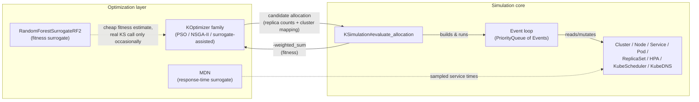

# KubeTwin Architecture

This document describes how KubeTwin is put together: the core object model, the discrete-event simulation loop, and the optimization layer built on top of it. It's aimed at someone who can already run a simulation (see the [README](README.md) and [`docs/CONFIGURATION.md`](docs/CONFIGURATION.md)) and now wants to extend the simulator itself — add a scheduling policy, a new event type, a new optimizer — or just understand why it behaves the way it does.

It ends with a critical assessment: a prioritized list of the architecture's weakest points, each grounded in specific code rather than general impressions. That section is opinionated by design — it's meant to be argued with, not treated as settled.


## Contents

- [The two halves of KubeTwin](#the-two-halves-of-kubetwin)
- [Object model](#object-model)
- [Configuration and the DSL](#configuration-and-the-dsl)
- [Infrastructure objects](#infrastructure-objects)
- [Kubernetes-shaped objects](#kubernetes-shaped-objects)
- [Requests and workflows](#requests-and-workflows)
- [Statistics and evaluation](#statistics-and-evaluation)
- [The event loop](#the-event-loop)
- [The optimization layer](#the-optimization-layer)

## The two halves of KubeTwin

KubeTwin is really two things stacked on top of each other:

1. **A discrete-event simulator** (`KSimulation`, and everything it constructs): given a fixed topology (clusters, nodes, latency model), a fixed set of microservices and workflows, and a candidate *allocation* (how many replicas of each microservice, and which cluster each replica lands in), it simulates requests flowing through the system and produces a single number — a weighted sum of mean response time and a handful of penalty terms — that scores how good that allocation is.
2. **An optimization layer** (`KOptimizer` and its five siblings, `MDN`, `RandomForestSurrogateRF2`) that searches the space of allocations for a good one, using the simulator from (1) as the fitness function it's trying to maximize (as `-weighted_sum` — see [`KSimulation#evaluate_allocation`](#the-event-loop)).

Everything else — `Cluster`/`Node`/`Pod`/`Service`/`HorizontalPodAutoscaler`/`KubeScheduler`/`KubeDNS` — exists to make (1) behave enough like a real Kubernetes deployment that the allocations (2) finds are meaningful.



## Object model

Grouped by role rather than by file, since the file layout (one class per file, flattened under `lib/kube_twin/`, resolved by [Zeitwerk](https://github.com/fxn/zeitwerk)) doesn't reflect these groupings directly.

| Group | Classes/modules |
|---|---|
| Configuration & DSL | `Configuration`, `Configurable` (dsl_accessor mixin), `ERV::GaussianMixtureHelper`/`GammaMixtureHelper` |
| Infrastructure | `Cluster`, `Node`, `DataCenter`, `LatencyManager`, `LatencyManagerFederation` |
| Kubernetes-shaped objects | `Service`, `ReplicaSet`, `Pod`, `Container`, `HorizontalPodAutoscaler`, `KubeScheduler`, `KubeDns` |
| Requests & workflow | `Request`, `RequestInfo`, `Event`, `WorkflowSequence`, `ChainTracker`, `RequestForwarder`, `NestedCallReturn`, `RequestGenerator`, `RequestGeneratorR` |
| Statistics & evaluation | `Statistics`, `ComponentStatistics`, `Evaluator` |
| Shared utilities | `Timespan` (unit-to-seconds helper, currently exercised only from specs), `Logging` (shared logger mixin, `logger.rb`, used by `Configuration` and `Evaluator`) |
| Simulation core | `KSimulation`, `PriorityQueue`, `AllocationReplay` |
| Optimization | `KOptimizer`, `KOptimizerACM`, `KOptimizerACM2`, `KOptimizerACM2Surrogate`, `KOptimizerACM2SurrogateRF2`, `KOptimizerMultiobjective`, `VectorCodec`, `MDN`, `RandomForestSurrogateRF2`, `SurrogateAnalysis` |

## Configuration and the DSL

A `.conf` file is not a data format that gets *parsed* — it's a Ruby script that gets *executed* against a `Configuration` object:

```ruby
# lib/kube_twin/configuration.rb
def self.load_from_file(filename, validate: true)
  conf = Configuration.new(filename)
  conf.instance_eval(File.new(filename, "r").read)   # <- runs the .conf file as Ruby
  conf.validate if validate
  conf
end
```

`Configuration` declares its DSL surface with `dsl_accessor` (`lib/kube_twin/support/dsl_helper.rb`) — each declared name (`clusters`, `federation`, `microservice_types`, `workflow_types`, `request_gen`, `policies`, …) becomes a method that, called with no arguments inside the `.conf` file, sets an instance variable. `Configuration#validate` then does light normalization (string→float conversions on times, filling in defaults, folding `request_gen`/`request_generation` together) — there's no schema validation beyond that; most structural mistakes in a `.conf` file surface later, as a `NoMethodError` or a `nil` somewhere deep in `KSimulation`, rather than at load time. `docs/CONFIGURATION.md` documents the DSL surface itself in detail (topology, workflow types, HPAs, policies) and is the right place to look for "what can I write in a `.conf` file" — this document is about what happens once it's loaded.

Two mutually-exclusive pairs are worth knowing about because they change which code path the rest of the simulator takes: `federation` (a JSON string, Liqo-style, hardcodes every cluster to `type: :mec, tier: "local"`) vs. `clusters` + `latency_models` (explicit, lower-level, requires a `tier:` per cluster) for topology; and `request_gen` (synthetic, `RequestGenerator`) vs. `request_generation` (CSV/R-script/command replay, `RequestGeneratorR`) for traffic. `federation` and `request_gen` win if both are present.

## Infrastructure objects

`Cluster` (`cluster.rb`) is a named collection of `Node`s (`node.rb`) with a type (`:mec`/`:cloud`), a tier, and a per-hour CPU/memory cost. `Node` tracks `resources_cpu`/`resources_memory` and `requested_resources`, and is where a pod's resource footprint is actually accounted for (`assign_resources`/`remove_resources`).

Latency between two locations is modeled by one of two interchangeable classes, selected by which topology mechanism the `.conf` file used: `LatencyManager` (for `clusters`/`latency_models`) precomputes a triangular matrix of `ERV::RandomVariable`s in its constructor, so `sample_latency_between` is an O(1) matrix lookup. `LatencyManagerFederation` (for `federation`) instead does a linear scan of `@latency_models` *inside* `sample_latency_between` itself, on every call — these two classes present the same interface but have very different performance characteristics, which matters because this method sits on the hottest path in the whole simulator.

## Kubernetes-shaped objects

These exist to make the simulation *feel* like a Kubernetes deployment, not to implement Kubernetes semantics:

- **`Service`** (`service.rb`) — a named group of `Pod`s keyed by label, with `:random` or round-robin (`:rr`) load balancing. `KubeDns` (`kube_dns.rb`) is a one-method-deep name→`Service` registry that `KSimulation` consults to resolve a component name to a service.
- **`ReplicaSet`** (`replica_set.rb`) — just a desired replica count plus a selector; doesn't create or destroy pods itself (`KSimulation` and the HPA control loop do that directly).
- **`Pod`** (`pod.rb`) wraps one **`Container`** (`container.rb`), which is where request queuing actually happens: `Container#new_request` enqueues a `RequestInfo` (a `Struct`), tracks queue/processing time, and is what schedules the `ET_WORKFLOW_STEP_COMPLETED` event once a request's simulated service time elapses (drawing that service time either from the microservice's configured distribution or, if `mdn_file` is set, from an `MDN`-modeled log-normal mixture via `KSimulation#retrieve_mdn_model`).
- **`HorizontalPodAutoscaler`** (`horizontal_pod_autoscaler.rb`) — the scaling *decision* (`#decide_scaling`, `#desired_metric`, `#average_processing_metric`) is pure and unit-tested in isolation; actually creating/destroying pods in response to that decision happens in `KSimulation`'s `ET_HPA_CONTROL` handler, since that needs `KubeScheduler`, `Service`, and `Pod`.
- **`KubeScheduler`** (`kube_scheduler.rb`) — decides which `Node` a new pod lands on. `#filter` builds a candidate list by scanning every node in every cluster for enough free CPU/memory; `#score` then picks one, preferring a `node_affinity`-matching tier if given, otherwise the least-loaded node by pod count. Every single pod placement — at startup and on every HPA scale-up — re-runs `#filter` from scratch.

## Requests and workflows

A `Request` (`request.rb`) is a fairly large state machine: it tracks queuing/transfer time, TTR (time-to-response) at both the step and chain level, and three distinct kinds of branching a workflow step can trigger — a **parallel** block (`start_parallel_execution`/`clone_for_parallel_branch`/`complete_parallel_branch`, tracking how many of N branches have finished), a **nested call** (`start_nested_calls`/`clone_for_nested_call`/`next_nested_call`, for a step that fans out to sub-services and waits for all of them before continuing), and a **chain** (`chain_entered`/`finished_chain`, for tracking a named sub-sequence's own latency separately from the whole workflow's, used by the `service_chain_max_latency_ms` policy). `WORKFLOW_MODELING.md` documents these three patterns from the `.conf`-author's side; `Request` is where they're actually implemented.

Four small, dependency-injected, unit-tested classes carry logic that used to be inline in `KSimulation`'s event loop:

- **`WorkflowSequence`** — pure functions over a workflow definition: what components does it contain, what's the component sequence for a given request (accounting for parallel-branch and nested-call overrides), what's the next component name.
- **`ChainTracker`** — pure predicates: is this request entering or exiting a policy-defined chain at this step.
- **`RequestForwarder`** — given a component name, a source location, a `LatencyManager`, and the current time, resolves it through `KubeDns` to a target `Pod` and computes the forwarding time and transmission latency. Used for every hop a request makes, including the very first one (from the customer's location) and cross-cluster forwards.
- **`NestedCallReturn`** — resolves the latency and cluster to return to when a nested call chain finishes and control returns to the parent request.

All four are pure given their inputs (no `@event_queue`, no simulation-wide state) — the mutation that goes with each decision (updating the request, incrementing counters, scheduling the actual event) stays in `KSimulation`, right next to the `@event_queue` it needs.

`RequestGenerator` (synthetic, `request_gen`) and `RequestGeneratorR` (CSV/R-script/command replay, `request_generation`) both implement the same `#generate(time) -> attrs_hash` interface that seeds `ET_REQUEST_GENERATION` events; `RequestGeneratorR#generate` returns `nil` once its source is exhausted, which is what actually stops that path (see the `@to_generate = Float::INFINITY` comment in `ksimulation.rb` for why the naive request-count gate doesn't apply to it).

## Statistics and evaluation

`Statistics` (`statistics.rb`) is an online mean/variance accumulator (Welford's algorithm) per (workflow type × customer) and per chain, plus configurable `longer_than`/`shorter_than` threshold counters used by latency policies; `ComponentStatistics` is the analogous per-microservice version, used both for the final report and, reset periodically, as the live signal each `HorizontalPodAutoscaler` scales against. Both keep an unbounded `@samples`/`@csv` array per instance for the life of a run — fine for the request counts these `.conf` files use today, worth watching if "large-scale" scenarios (the open Phase 4 performance item) become a real target. `Evaluator` (`evaluation.rb`) computes fixed infrastructure costs from `evaluation[:cluster_hourly_cost]`; `KSimulation#evaluate_allocation` computes its own node/hour cost inline rather than through `Evaluator`, so in practice `Evaluator` isn't on the main scoring path today.

## The event loop

`Event` (`event.rb`) is a plain value object — `type`, `data`, `time`, `destination` — ordered by `time` via `Comparable`. `PriorityQueue` (`priority_queue.rb`) is a binary min-heap keyed on `(time, sequence_id)` (the sequence id breaks ties so same-time events stay in insertion order, for determinism) — it replaced an earlier sorted-array implementation for the same reason any event-driven simulator needs a real priority queue: pulling the next event and inserting a new one both need to be faster than O(n) once the queue gets large. This part of the design is already in good shape.

There are eleven event types (`ET_END_OF_SIMULATION` is 100, the rest are 0–12 with a couple of gaps reserved for VM suspend/resume, never implemented):

| Event | Triggered by | Handles |
|---|---|---|
| `ET_REQUEST_GENERATION` | a `RequestGenerator`/`RequestGeneratorR` | creates a `Request`, routes its first hop, schedules `ET_REQUEST_ARRIVAL`, and (if not exhausted/past cooldown) schedules the next generation |
| `ET_REQUEST_ARRIVAL` | the above | counts the request as arrived (if past warmup), schedules `ET_REQUEST_FORWARDING` to the resolved pod |
| `ET_REQUEST_FORWARDING` | arrival, or any step completion that routes onward | enqueues the request on the target `Container` |
| `ET_WORKFLOW_STEP_COMPLETED` | a `Container` finishing a request's service time | the largest handler by far — chain entry/exit, nested-call dispatch, parallel-branch fan-out/join, routing to the next step or closing the request |
| `ET_REQUEST_CLOSURE` | the end of `ET_WORKFLOW_STEP_COMPLETED` for a top-level request | records final TTR into `Statistics` |
| `ET_HPA_CONTROL` | scheduled periodically per HPA | samples pod metrics, calls `HorizontalPodAutoscaler#decide_scaling`, creates/destroys pods, reschedules itself |
| `ET_STATS_PRINT` | `stats_print_interval`, if configured | prints and resets `ComponentStatistics` |
| `ET_ALLOCATE_NODE` / `ET_DEALLOCATE_NODE` | scheduled externally (not by any handler above) | adds/removes a `Node` from a `Cluster` — present but not currently driven by anything in the core loop |
| `ET_END_OF_SIMULATION` | `configuration.end_time`, if set | drains the rest of the queue |

The life of one request: `ET_REQUEST_GENERATION` → `ET_REQUEST_ARRIVAL` → `ET_REQUEST_FORWARDING` → (queued on a `Container`, which schedules) → `ET_WORKFLOW_STEP_COMPLETED`, which either loops back to `ET_REQUEST_FORWARDING` for the next step, fans out into several parallel `ET_REQUEST_FORWARDING`s that each eventually rejoin, dispatches a nested call (another `ET_REQUEST_FORWARDING` for a child `Request`, returning via `NestedCallReturn` when done), or — if the workflow is finished and there's no parent request — schedules `ET_REQUEST_CLOSURE`.

For the moment **all of this lives inside one method.** `KSimulation#evaluate_allocation` (`ksimulation.rb:157`–`1341`, roughly 1,185 of the file's 1,440 lines) does three things in sequence, with no internal method boundaries between them:

1. **Setup** (~500 lines): parse `federation`/`clusters` into `Cluster`+`Node` objects, build the `LatencyManager`, instantiate `MDN` models for any microservice with `mdn_file` set, build every `Statistics`/`ComponentStatistics` bucket, parse `policies`, then create every `ReplicaSet`, `Service`, `Pod`, and `HorizontalPodAutoscaler` and place every initial pod via `KubeScheduler`.
2. **The event loop** described above: `until @event_queue.empty? ... end`.
3. **Wind-down** (~150 lines): compute allocation/spreading statistics (including a Gini-coefficient-based replica-spreading penalty), assemble `weighted_sum` from mean TTR plus every penalty term, write `final_allocation.txt`/`.json` to disk, and return `-weighted_sum`.

We are in the process of refactoring and improving this code.


## The optimization layer

Six `KOptimizer*` classes wrap this simulator as a fitness function for different search strategies — PSO (`KOptimizer`, `KOptimizerACM`, `KOptimizerACM2`), NSGA-II-style multiobjective search (`KOptimizerMultiobjective`), and two surrogate-assisted variants (`KOptimizerACM2Surrogate`, `KOptimizerACM2SurrogateRF2`) that train a cheap model (Rumale `RandomForest`, via `RandomForestSurrogateRF2`) on a batch of real evaluations and search *that* instead, falling back to the real simulator only to validate the surrogate's top candidates. `VectorCodec` (`vector_codec.rb`) holds the encoding/decoding these all share: turning a flat numeric vector (what the PSO/GA solver actually searches over) into a replica-set hash and a cluster mapping, and back.

`MDN` (`mdn.rb`) is a small Torch-backed mixture-density network that, given a request rate, predicts a log-normal mixture for service time — used in place of a fixed distribution when a microservice's `mdn_file` is configured, loaded once per `evaluate_allocation` call and cached per (microservice, rounded RPS) pair for the life of that call.

The important architectural fact here: every one of these optimizers — surrogate-assisted or not — evaluates a candidate by constructing a brand-new `KSimulation` and calling `evaluate_allocation` (or `evaluate_allocation_multiobjective`, a thin wrapper that returns the individual metrics instead of the weighted scalar). There's no cheaper, partial way to ask "how good is this allocation" than running the whole thing from scratch.

